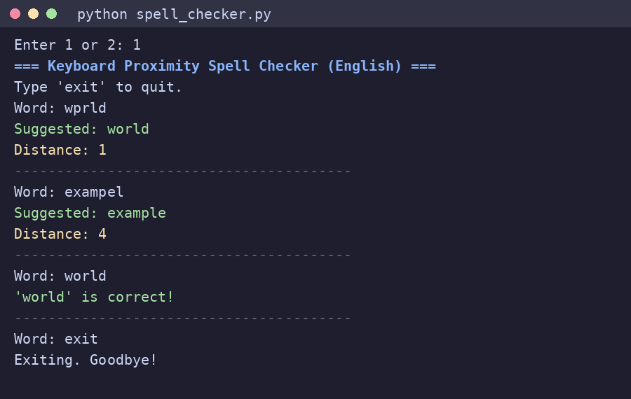

# Keyboard Proximity Spell Checker (English & Persian)

A small command-line spell checker that suggests corrections using a **keyboard-aware distance**: substituting a character with a neighbouring key costs less than substituting an unrelated one. Supports **English** and **Persian (فارسی)**.

> Author: 'danial moradi'

## How it works

1. **Dictionary** – the top 200,000 words of the chosen language from [`wordfreq`](https://github.com/rspeer/wordfreq), together with their Zipf frequency.
2. **Preprocessing** – lowercase, then keep only letters of the selected alphabet.
3. **Candidates** – dictionary words with the same length as the input; if none exist, words within ±2 characters.
4. **Distance** – compared position by position: equal letters cost 0, neighbouring keys cost 1, other substitutions cost 2, plus a penalty for length differences (see `keyboard_distance`).
5. **Ranking** – lowest distance first, ties broken by higher word frequency, then alphabetically.

## Requirements

- Python 3.9+ (the code uses `list[str]` / `tuple[...]` type hints)
- `wordfreq`

## Installation

```bash
python -m venv .venv
.venv\Scripts\activate          # Windows  (Linux/macOS: source .venv/bin/activate)
pip install -r requirements.txt
```

## Usage

```bash
python spell_checker.py
```

Choose `1` (English) or `2` (فارسی), then type a word. Type `exit` (or `خروج`) to quit.



*Rendered from the captured output of a real run (English mode).*

Example outputs observed when running the code:

| Input | Suggestion | Distance |
|---|---|---|
| `wprld` | `world` | 1 |
| `exampel` | `example` | 4 |
| `کتاا` | `کتاب` | 2 |
| `مدرسع` | `مدرسه` | 2 |

## Limitations

- Distance is **positional**, not a full edit distance: a transposition (`exampel`) is costly, and a missing or extra letter is penalised heavily.
- Candidates are mostly restricted to words of the **same length**, so missing/extra-letter typos are usually not corrected.
- The `wordfreq` word lists contain common misspellings and slang (e.g. `helo`, `wrld`, `teh` are accepted as correct in English).
- The Persian list returns about 31,000 words, not 200,000, so coverage is smaller.
- The keyboard-neighbour tables (especially Persian) are hand-written and incomplete.
- All candidates are rescanned for every query (~0.1 s each in a quick test).

## Future improvements

- Damerau–Levenshtein distance with keyboard-weighted substitution costs.
- Pre-indexed candidates (BK-tree or SymSpell-style) for speed.
- Complete and symmetric neighbour maps for both layouts; Arabic ي/ك → Persian ی/ک normalization.
- Unit tests.

## License and attribution

Code: <CHOOSE A LICENSE, e.g. MIT>. Word lists and frequencies come from the `wordfreq` package; see its license.
